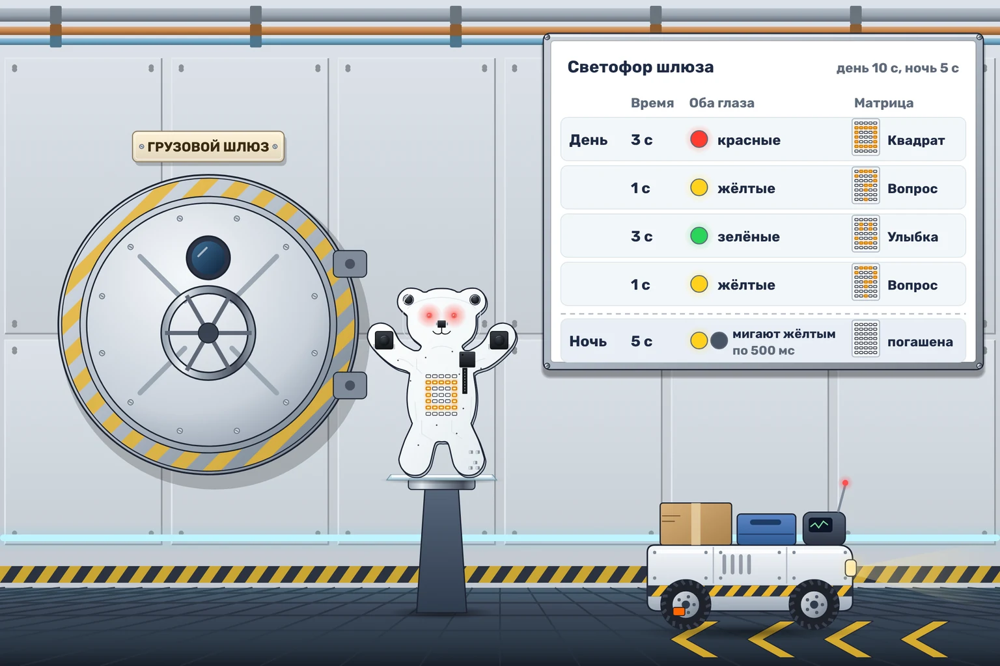

# Светофор шлюза

Через грузовой шлюз «Орбиты-7» весь день проходят тележки. Мишка показывает водителям, когда ждать и когда ехать. Ночью шлюз закрывают, но предупреждающий огонь должен продолжать мигать, чтобы сонный водитель не принял закрытую дверь за свободный проезд.

Запуск начинается с дневного режима. Днём повторяйте последовательность:

| Длительность | Оба глаза | Живот |
|---|---|---|
| 3 секунды | Красные | Квадрат |
| 3 секунды | Зелёные | Улыбка |
| 1 секунда | Жёлтые | Вопрос |

**День длится ровно 12 секунд**, даже если очередной цвет ещё не успел догореть. Затем на **5 секунд** наступает ночь: живот погашен, оба глаза мигают жёлтым — 500 мс горят, 500 мс не горят. Ночь начинается с горящих глаз.

После ночи начинается новый день, обязательно с красного цвета и квадрата. Продолжайте сменять день и ночь. Время здесь сжато, поэтому весь распорядок можно увидеть за несколько секунд.
