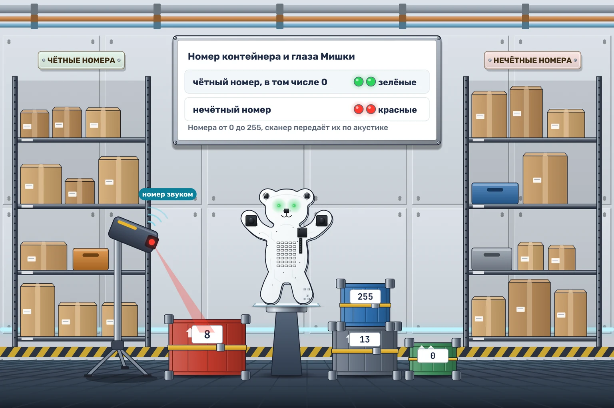

# Сортировка грузов

На склад «Орбиты-7» поступила новая партия контейнеров. Левая полка предназначена для чётных номеров, правая — для нечётных. Сканер сообщает номера по акустической линии, а Мишка переводит их в понятные грузчику световые сигналы.

На каждый байт **по акустике** отвечайте цветом обоих глаз:

- **Чётный номер**, включая 0, — зелёные глаза.
- **Нечётный номер** — красные глаза.

Входные числа лежат в диапазоне **0–255**. Цвет сохраняется до следующего акустического байта; до первого байта глаза погашены. Живот всегда погашен. ИК-сообщения пропускайте.

Для пробы подайте числа **8, 13, 0, 255** по акустике в моменты **1, 2, 3 и 4 секунды**: глаза должны стать зелёными, красными, зелёными и красными.

Остаток от деления на 2 можно вычислить калькулятором. Он сам не создаёт событие: после расчёта можно вызвать «Своё событие» и проверить результат в условиях.
