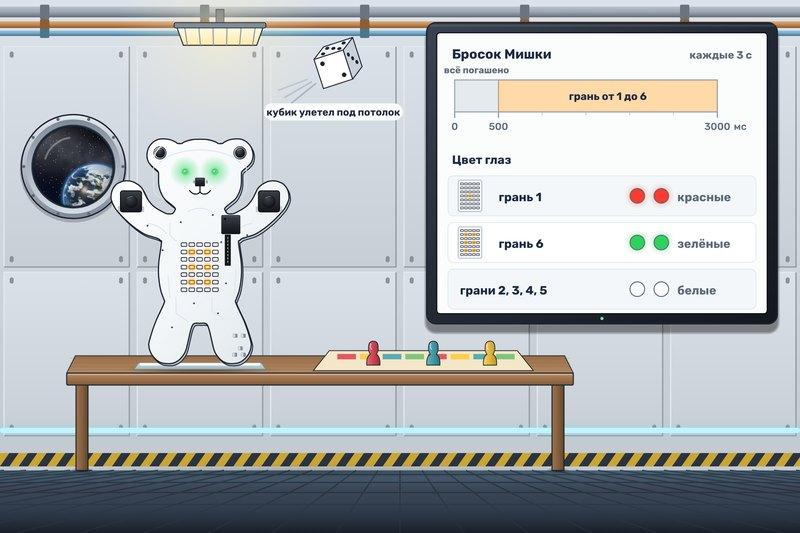
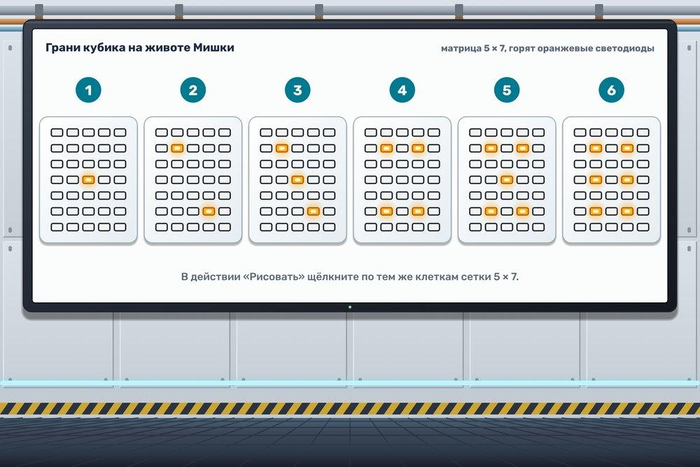

# Кубик

Экипаж собрался за настольной игрой, но первый же бросок закончился погоней за кубиком. В невесомости он улетел под потолок. Мишка предлагает замену. На его животе хватит места для всех шести граней, а глаза помогут сразу заметить самый удачный и самый неудачный бросок.

Каждые 3 секунды Мишка бросает кубик, первый раз сразу после запуска. Бросок устроен так:

- первые 500 мс оба глаза и живот погашены;
- следующие 2500 мс на животе горят точки случайной грани от 1 до 6;
- на единице глаза красные, на шестёрке зелёные, на остальных гранях белые.

Точки и цвет глаз берите из одного и того же броска. Грань и цвет горят до следующего броска. Одна грань может выпасть несколько раз подряд. У генератора случайностей задайте начало 1 и конец 7.

Точки рисуйте компонентом «Матрица светодиодов», действием «Рисовать». В этом действии есть сетка 5 × 7, щелчок по клетке включает светодиод. Расставьте точки, как на рисунке, яркость оставьте 100.

