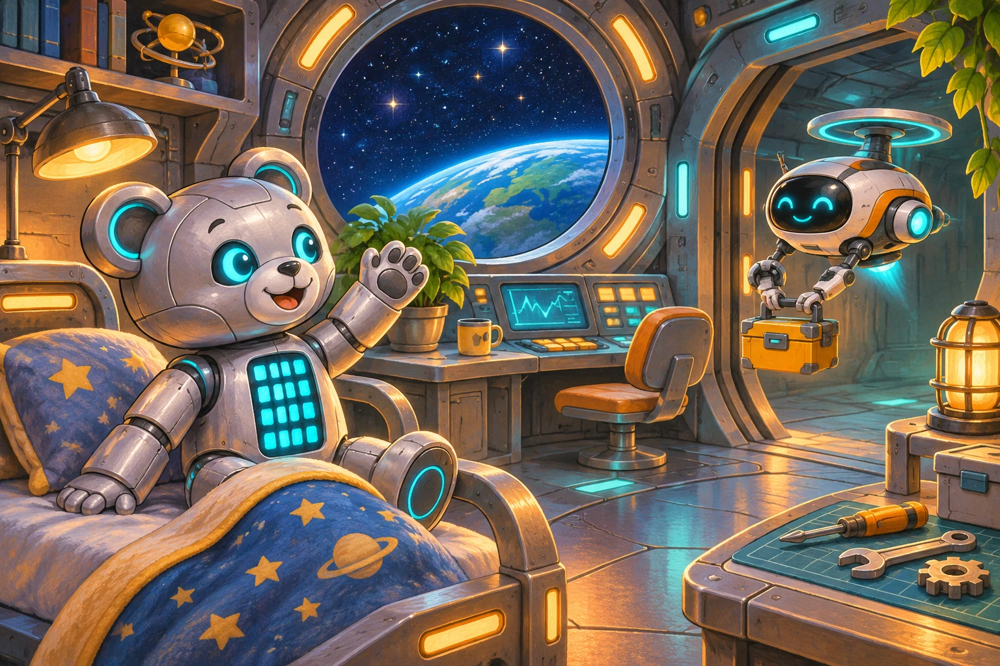

# Привет, Мишка

После долгого перелёта на станции «Орбита-7» включают бортовых помощников. КиберМишка уже включён, но здороваться пока не умеет. Экипаж решил, что Мишка будет здороваться ровным миганием глаз: такое мигание видно даже через стекло соседнего отсека.

Постройте для КиберМишки диаграмму приветствия. Сразу после запуска оба глаза загораются циановым. Через **500 мс** глаза гаснут, ещё через **500 мс** загораются снова, и так без остановки. Матрица всё время выключена.

Цвет возьмите из палитры, он называется «Циановый».
