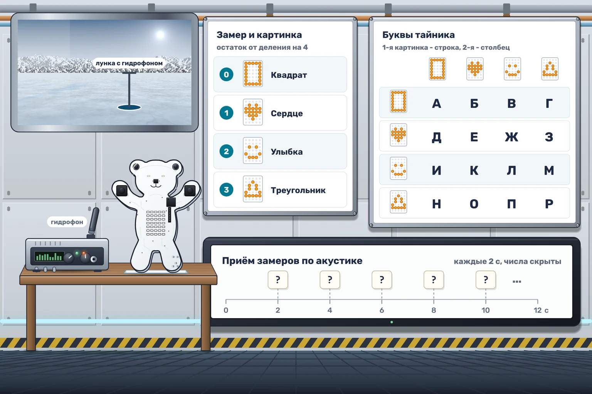

# Тайник в замерах

Зонд Тынлау-50 исследует океан подо льдом Крифа-4. Каждые две секунды он передаёт на базу очередной замер - число от 0 до 255. Звук под водой расходится далеко, и его могут услышать чужие приёмники. Поэтому зонд спрятал важное сообщение в обычных замерах. Мишка покажет знаки, а вы прочитаете тайник.

Каждый замер приходит по акустике. Найдите остаток от деления замера на 4 и покажите на матрице картинку из таблицы.

| Остаток | Картинка |
|---|---|
| 0 | Квадрат |
| 1 | Сердце |
| 2 | Улыбка |
| 3 | Треугольник |

Картинка горит ровно 1 секунду, потом матрица гаснет до следующего замера. До первого замера матрица выключена, глаза всё время погашены. Байты по ИК пропускайте.

Замеры подаёт симулятор. Первый замер приходит на отметке 2 с, следующие - каждые 2 секунды. Числа замеров скрыты. Запустите тест «Секретные замеры», запишите картинки по порядку и разбейте их на пары. Если две картинки подряд одинаковые, это два знака, и между ними матрица гаснет.

Первая картинка пары задаёт строку таблицы, вторая - столбец.

|  | Квадрат | Сердце | Улыбка | Треугольник |
|---|---|---|---|---|
| Квадрат | А | Б | В | Г |
| Сердце | Д | Е | Ж | З |
| Улыбка | И | К | Л | М |
| Треугольник | Н | О | П | Р |

Буквы складываются в слово. Введите это слово в ответ на курсе. Во втором тесте числа другие, а остатки и тайник те же.
