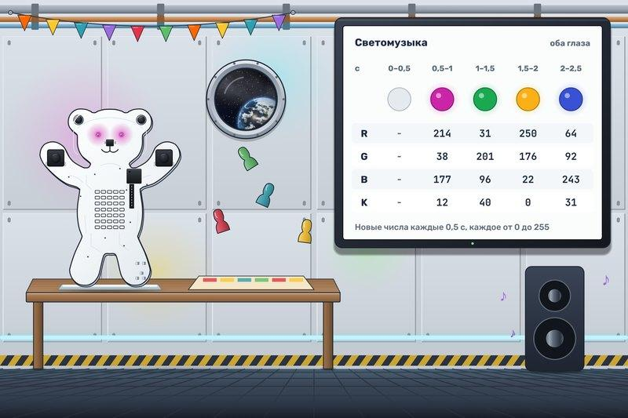

# Светомузыка

Грузовой корабль благополучно пришвартовался, и в кают-компании устроили праздник. Музыка уже играет, фишки настольной игры парят над столом, а Мишке досталась работа осветителя. Экипаж просит побольше красок: серое мерцание для такого вечера слишком скучное.

Каждые **500 мс** задавайте обоим глазам новый случайный цвет. Цвет глаз задают действием «Задать цвет из RGBK» четырьмя числами. **R**, **G** и **B** означают, сколько светят красный, зелёный и синий светодиоды глаза. **K** («Чёрный») затемняет цвет: чем это число больше, тем глаз темнее.

Каждое из четырёх чисел выбирайте случайно и отдельно от остальных, от **0 до 255** включительно. Для этого в генераторе случайностей задайте начало 0 и конец 256.

Первый цвет загорается через 500 мс после запуска, до этого глаза погашены. Новый цвет держится до следующего выбора. Матрица всё время выключена. Иногда цвет совпадёт с прошлым или выйдет серым, это допустимо. Но светомузыка целиком серой быть не должна.

Генератор помнит только последнее число, которое выдал. В действии «Задать цвет из RGBK» у каждого числа есть переключатель. Если его включить, вместо числа можно выбрать атрибут генератора «Целое число».
