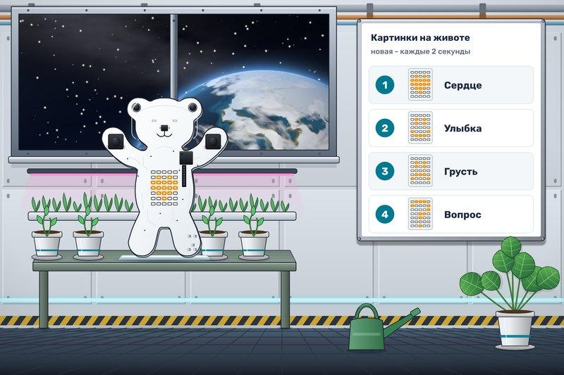

# Настроение Мишки

В оранжерее «Орбиты-7» растениям хватает света и воды, а людям после долгой смены иногда не хватает хорошего настроения. Мишка решил встречать гостей маленькими световыми открытками. Никто не знает, какую картинку он покажет следующей.

Каждые **2 секунды** выбирайте случайное число от **1 до 4** и показывайте на животе соответствующую готовую картинку:

| Число | Картинка |
|---|---|
| 1 | Сердечко |
| 2 | Улыбка |
| 3 | Грустный смайлик |
| 4 | Вопрос |

Первый выбор происходит через 2 секунды после запуска; до него матрица пуста. Картинка сохраняется до следующего выбора. Одинаковые картинки подряд допустимы. Глаза остаются выключенными.

У генератора верхняя граница не входит в диапазон: для чисел 1–4 задайте **[1; 5)**. Чтобы проверить полученное число в условиях, после генерации можно вызвать компонент «Своё событие».
