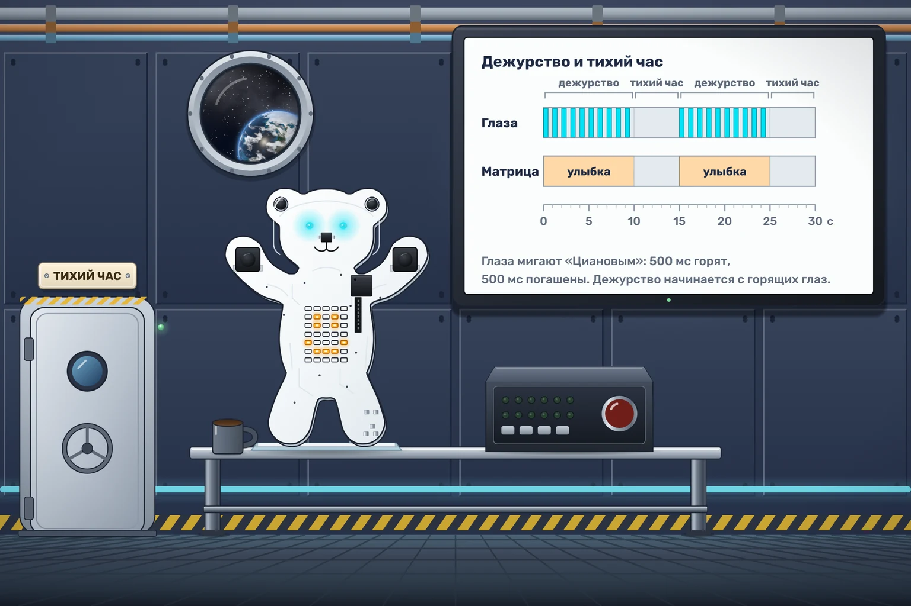

# Тихий час

На «Орбите-7» даже роботам положен отдых. Пока Мишка дежурит, улыбка на животе сообщает, что всё в порядке, а голубое мигание глаз помогает экипажу найти пульт в полумраке. Когда наступает тихий час, свет нужно полностью выключить, чтобы не будить соседний отсек.

Сразу после запуска Мишка приступает к дежурству:

- На животе постоянно горит **улыбка**.
- Оба глаза мигают **голубым**: 500 мс горят, 500 мс погашены. Дежурство начинается с горящих глаз.
- Через **10 секунд от начала дежурства** глаза и живот гаснут на **5 секунд**.

После отдыха начинается новое десятисекундное дежурство, снова с улыбки и горящих глаз. Повторяйте этот распорядок бесконечно. Отсчёт до отдыха идёт независимо от фаз мигания.
