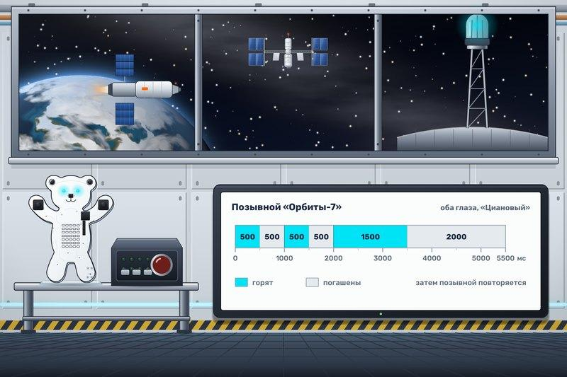

# Позывной станции

Корабль снабжения выходит из тени планеты. Впереди несколько станций, и у каждой свой световой позывной. «Орбиту-7» узнают по двум коротким вспышкам и одной длинной. КиберМишка управляет маяком станции, и его глаза мигают в ритме маяка.

Сразу после запуска начните повторять позывной. Оба глаза мигают циановым, этот цвет есть в палитре. Позывной устроен так:

- горят 500 мс, погашены 500 мс;
- горят 500 мс, погашены 500 мс;
- горят 1500 мс, погашены 2000 мс.

Весь позывной занимает 5500 мс, и сразу за ним начинается следующий. Живот всё время выключен.

Сверьте позывной в симуляторе. Через 0,25 с после запуска глаза горят, через 0,75 с погашены. На отметке 3 с идёт длинная вспышка, на отметке 4,5 с длинная пауза, а с 5,5 с начинается новый позывной.
