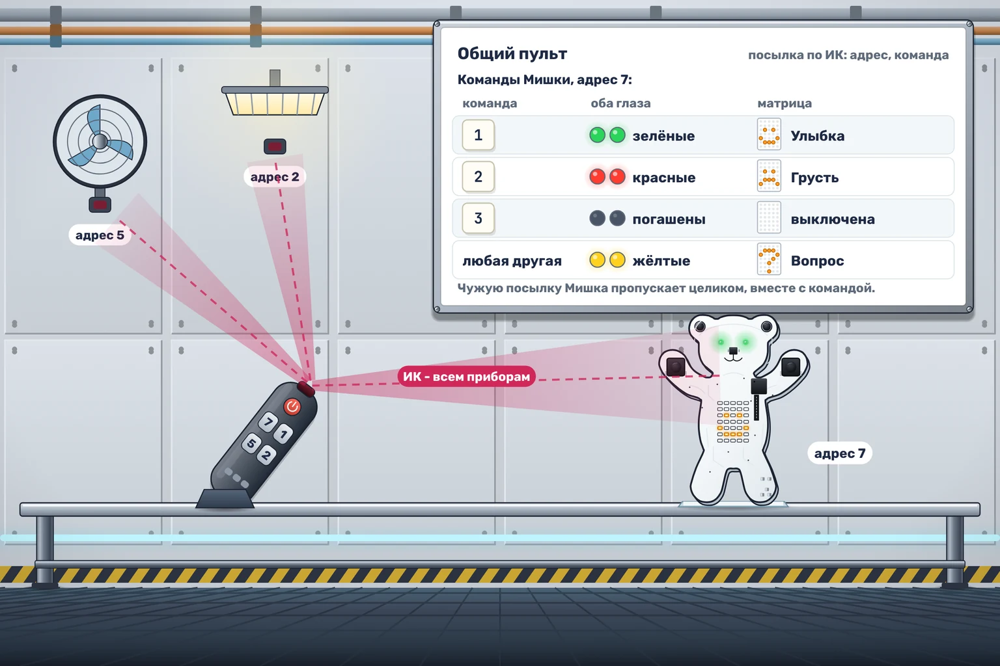

# Пульт станции

В отсеке станции слишком много пультов, и инженер собрал один общий. Теперь каждый прибор получает посылку с собственным адресом. Мишке назначили адрес 7. Нужно научить его слушать только свои команды, даже когда в чужой посылке случайно встречается семёрка.

Каждая ИК-посылка состоит из **двух байтов: адреса и команды**. Читайте поток неперекрывающимися парами с начала запуска. Выполняйте команду **только при адресе 7**:

| Команда | Оба глаза | Живот |
|---|---|---|
| 1 | Зелёные | Улыбка |
| 2 | Красные | Грустный смайлик |
| 3 | Погашены | Погашен |
| Любая другая | Жёлтые | Вопрос |

Чужую посылку пропускайте **целиком, вместе с командой**. Адрес сам по себе экран не меняет. До первой своей полной посылки глаза и живот погашены; затем результат сохраняется до следующей своей команды. Акустические байты пропускайте. Последний адрес без команды ничего не меняет.

Проверка: по ИК приходят **7, 1, 5, 7, 7, 2** в моменты **1, 2, 3, 4, 5 и 6 секунд**. После пары 7, 1 Мишка улыбается зелёными глазами; после 5, 7 ничего не меняется; после 7, 2 показывает грустный смайлик и красные глаза.
