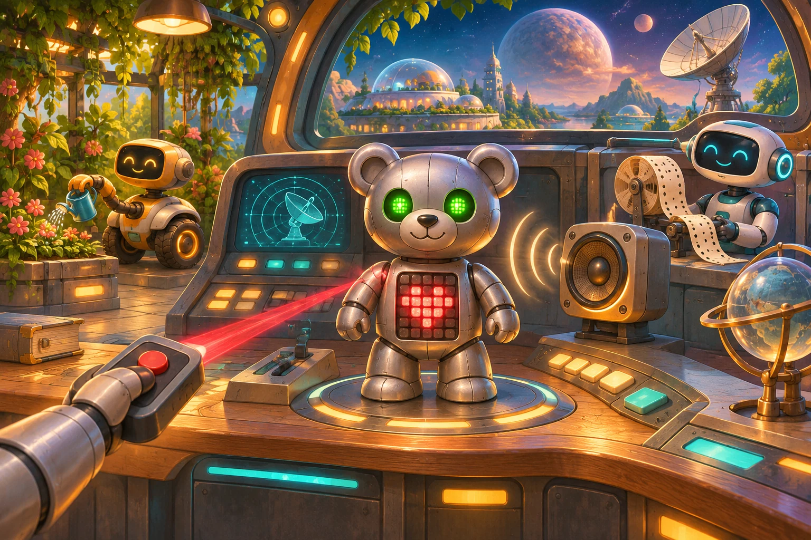

# Два канала сразу

Художник станции отправляет Мишке световые открытки с ИК-пульта. В каждой открытке есть картинка и цвет глаз, поэтому она занимает два байта. Иногда дежурный связист просит по акустике ненадолго выключить свет. После такой команды Мишка должен помнить, какая часть открытки уже пришла.

Байты по ИК читайте парами: первый и второй, третий и четвёртый и так далее. Первый байт пары - номер картинки, второй - номер цвета обоих глаз. Новую открытку показывайте только после второго байта, до него горит прошлая открытка.

| Первый байт | Картинка | Второй байт | Цвет глаз |
|---|---|---|---|
| 1 | Сердце | 1 | Красный |
| 2 | Улыбка | 2 | Зелёный |
| 3 | Вопрос | 3 | Циановый |
| 4 | Квадрат | 4 | Жёлтый |
|  |  | 5 | Белый |

В тестах номер картинки всегда от 1 до 4, номер цвета - от 1 до 5.

По акустике в любой момент может прийти 0. Тогда сразу погасите глаза и матрицу. После этой команды Мишка продолжает принимать пару по ИК с того же места. Другие байты по акустике ничего не меняют. До первой полной открытки глаза и матрица погашены.

Пример: на отметке 1 с по ИК приходит 1, на отметке 1,5 с по акустике 0, на отметке 2 с по ИК 2. В конце на матрице «Сердце», глаза зелёные.
