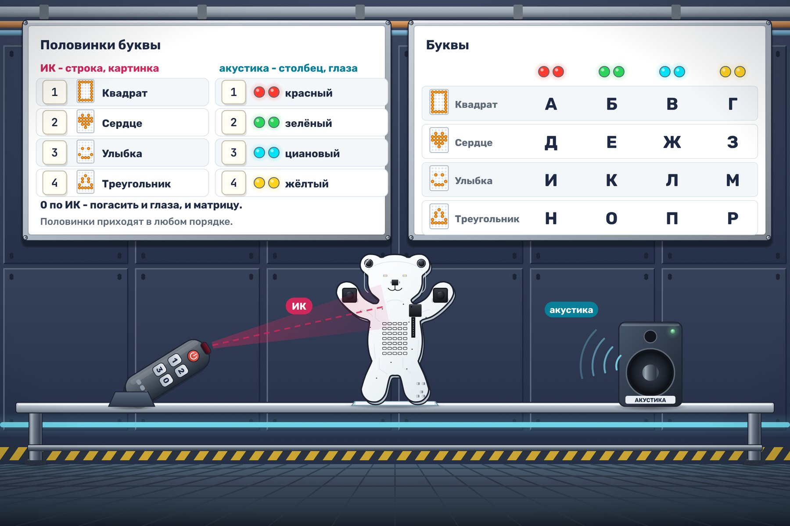

# Две половинки

В закрытом отсеке «Орбиты-7» Мишке передают тайное слово. Каждую букву разделили на две половинки, чтобы её нельзя было прочитать по одному каналу. ИК-пульт передаёт строку таблицы, акустический передатчик - столбец. Мишка соединит половинки светом, а вы прочитаете сообщение.

По ИК приходит номер строки. Сразу покажите его картинкой на матрице.

| Байт по ИК | Картинка |
|---|---|
| 1 | Квадрат |
| 2 | Сердце |
| 3 | Улыбка |
| 4 | Треугольник |

По акустике приходит номер столбца. Сразу покажите его цветом обоих глаз: 1 - красный, 2 - зелёный, 3 - циановый, 4 - жёлтый.

Перед каждой буквой по ИК приходит 0. Погасите и глаза, и матрицу, чтобы прошлая буква не смешалась с новой. До первого сообщения они тоже погашены. Другие байты по обоим каналам пропускайте.

Половинки одной буквы приходят в любом порядке. Когда приходит вторая половинка, первая остаётся на месте. Если горят и матрица, и глаза, буква готова.

Запустите тест «Секретное сообщение», запишите готовые пары и прочитайте буквы по таблице.

|  | Красный | Зелёный | Циановый | Жёлтый |
|---|---|---|---|---|
| Квадрат | А | Б | В | Г |
| Сердце | Д | Е | Ж | З |
| Улыбка | И | К | Л | М |
| Треугольник | Н | О | П | Р |

Симулятор передаёт 21 скрытый байт примерно за 20 секунд. Буквы складываются в слово. Введите это слово в ответ на курсе.
