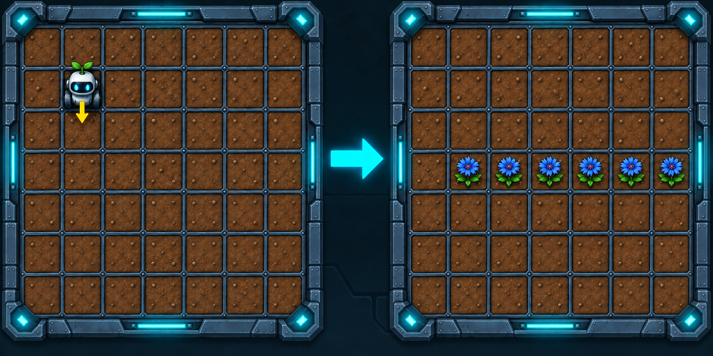

# Васильковая тропа

На исследовательской станции планеты Кинерма готовятся встречать грузовой звездолёт. Из-за магнитной бури посадочные маяки вышли из строя, поэтому экипаж решил обозначить безопасное направление с помощью ярких васильков, хорошо заметных с воздуха.

Роботу-садовнику поручено проложить через центр посадочной площадки ровную васильковую тропу.

## Условия

- Посадочная площадка имеет размер **7×7 клеток**.
- Садовник начинает в клетке **(1; 1)** и смотрит на юг.
- По внешним краям площадки находятся непроходимые границы.
- Васильками нужно засадить центральную, четвёртую сверху строку от клетки **(1; 3)** до клетки **(6; 3)**.
- Клетка **(0; 3)** и остальные клетки должны остаться пустыми.
- Итоговые положение и направление Садовника не проверяются.

Создайте диаграмму машины состояний, которая подготовит васильковый ориентир к прибытию звездолёта.
