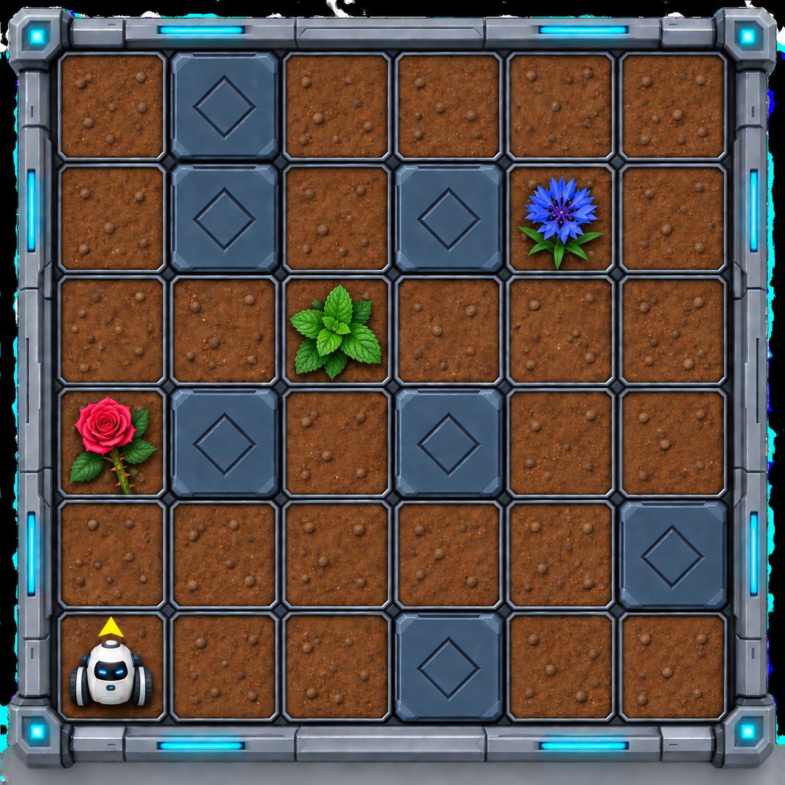

# Космическая доставка

На заброшенной космической станции снова заработала система доставки грузов. Роботу Садовнику поручено пройти по маршруту и доставить растения на три грузовые станции.

Маршрут расположен на поле **6×6 клеток**. Каждая станция обозначена уже посаженным цветком-маяком: розой, васильком или мятой. **Клетка непосредственно севернее маяка** — пустая посадочная платформа, на которой нужно высадить груз. Через клетки с маяками можно проходить, но заменять их цветы нельзя.

На схеме показана постоянная карта: роза слева, мята в центре, василёк справа. Садовник начинает в клетке **(0; 5)** и смотрит на север. Тёмные клетки непроходимы.

Грузовой манифест оказался повреждён. Сохранились только три записи:

- ни одна станция не принимает такое же растение, как её маяк;
- **мяту** нужно доставить к маяку с шипами;
- **розу** нужно доставить к васильковому маяку.

Создайте машину состояний, которая проведёт Садовника по маршруту. У каждого маяка определите груз по виду цветка, перейдите в клетку севернее и посадите нужное растение. Затем продолжите путь к следующему маяку. После доставки на третью станцию завершите работу на её посадочной платформе. Остальные клетки и маяки должны остаться без изменений.
