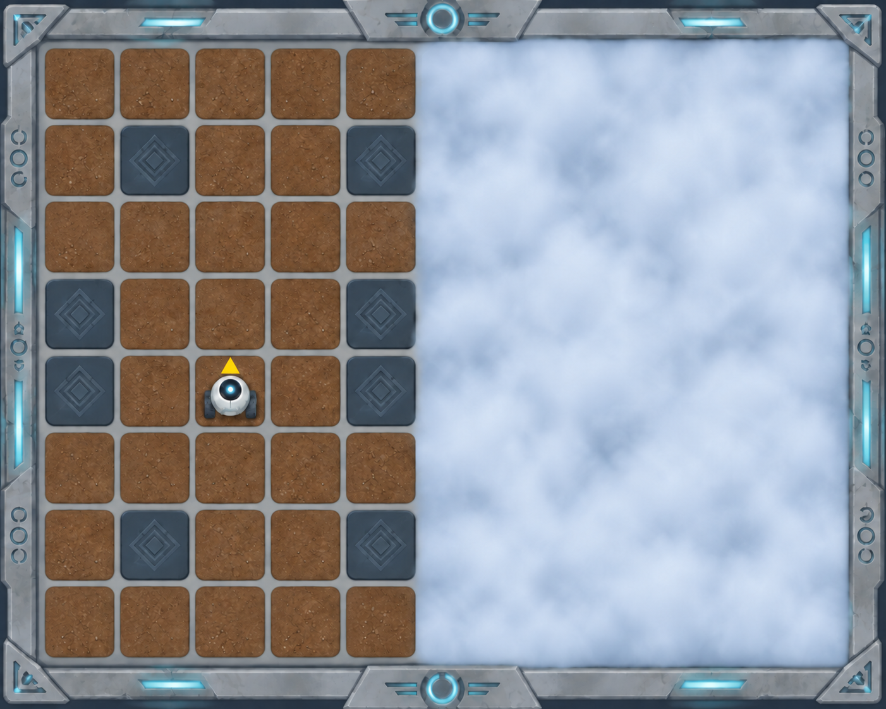

# Садовник в тумане

Робот Садовник исследует заброшенный сад древней космической цивилизации. Пока он выполнял задание, территорию накрыл густой туман, скрывший половину поля.

Исследователи выяснили, что сад построен симметрично: его левая и правая части зеркально повторяют друг друга. Значит, расположение проходов в тумане можно определить по открытой части сада.

Помогите Садовнику добраться от стартовой клетки до её зеркального отражения на другой стороне поля.

## Условия

- Размер сада — **10×8 клеток**. Правая половина скрыта туманом, но повторяет левую зеркально относительно вертикальной оси между пятым и шестым столбцами.
- Тёмные клетки на карте — непроходимые стены. Клетки под туманом могут быть как свободными, так и стенами.
- Садовник начинает в клетке **(2; 4)** и смотрит на север.
- Цель — зеркальная клетка **(7; 4)**. Достаточно оказаться в ней; направление Садовника не проверяется.

Составьте диаграмму машины состояний, которая проведёт Садовника через сад.
