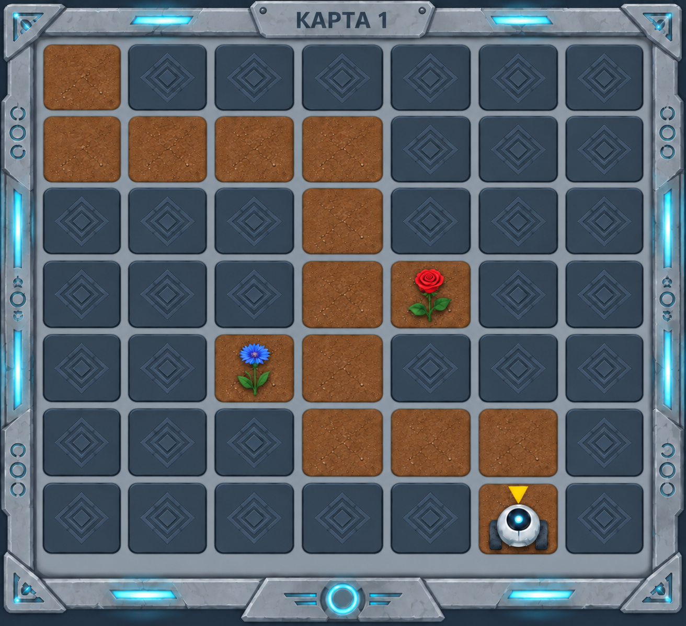
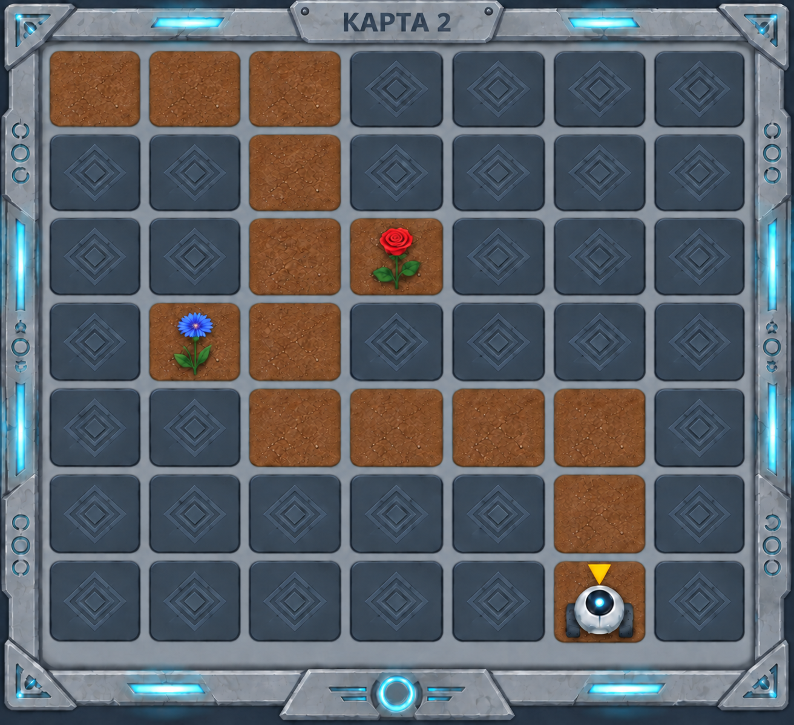
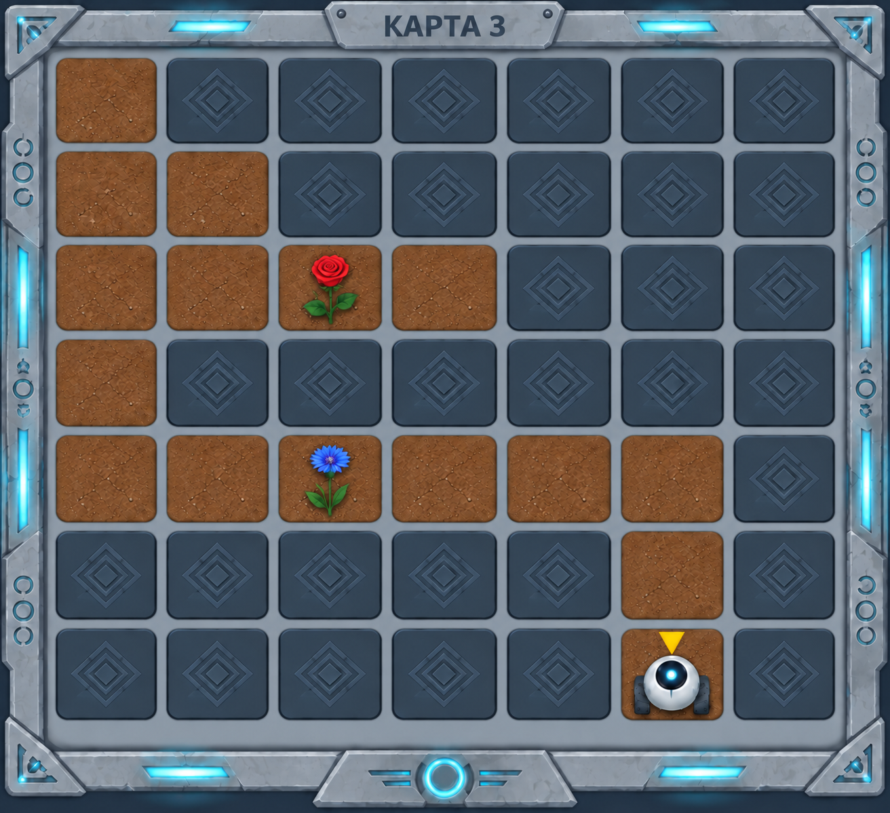

# В поисках правды

Исследуя архивы древней станции, Садовник обнаружил три карты одного и того же сектора. Карты заметно отличаются друг от друга, но только одна из них настоящая. Две другие были повреждены и содержат неверные сведения о расположении стен и проходов.

Определить правильную карту помогут сохранившиеся показания навигационных маяков.

## Показания маяков

- От начальной позиции Садовника до стены на севере находятся две свободные клетки.
- Справа от клетки с розой расположена стена.
- Клетка с васильком находится в тупике.
- Кратчайший путь до левой верхней клетки поля содержит три поворота.

## Условие задачи

Изучите три карты и определите, какая из них соответствует всем показаниям маяков.

На каждой карте робот показывает начальную позицию Садовника, а жёлтая стрелка — направление, в котором он смотрит. Роза и василёк служат ориентирами; сажать их не нужно.

После выбора правильной карты создайте машину состояний, которая:

- приведёт Садовника в левую верхнюю клетку поля;
- не позволит роботу столкнуться со стенами.

Итоговое направление Садовника не проверяется.
