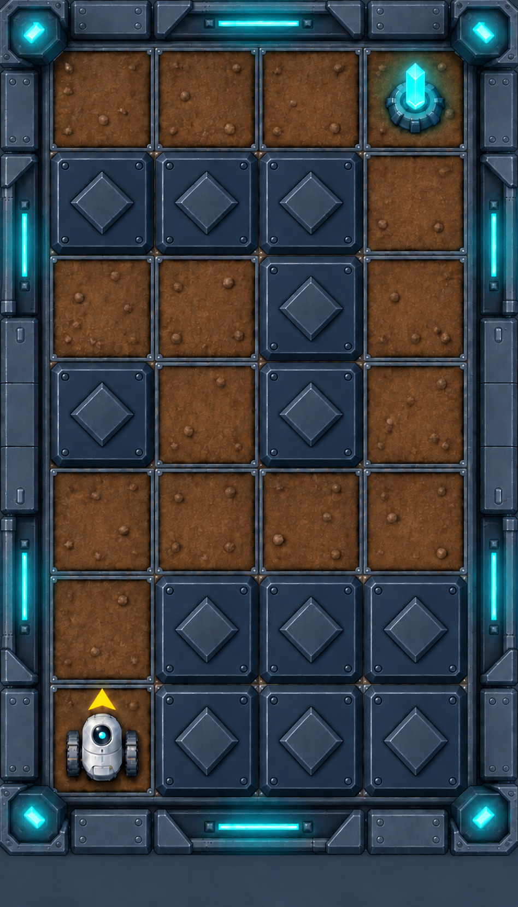

# "Неуч"-картограф

Исследовательский дрон составил карту одного из садов древней цивилизации. Он правильно отметил расположение стен, порядок поворотов и навигационный маяк, но ошибся при подсчёте клеток.

Настоящая карта может оказаться больше или меньше изображённой, а прямые участки маршрута — длиннее или короче. Садовник начинает в нижнем левом углу и смотрит на север. Тёмные клетки непроходимы. Кристалл на рисунке обозначает навигационный маяк; на поле испытания его обозначает **василёк**. Сажать растения не требуется.

Порядок движения остаётся неизменным:

1. Двигаться на север до стены.
2. Повернуть направо и двигаться до следующей стены.
3. Повернуть налево и продолжать движение до навигационного маяка.

Создайте машину состояний, которая приведёт Садовника к маяку при любом размере поля. Определяйте момент каждого поворота с помощью сенсора стены, не отсчитывая клетки. Достигнув маяка, остановитесь и завершите работу. Поле должно остаться без изменений; итоговое направление не проверяется.
