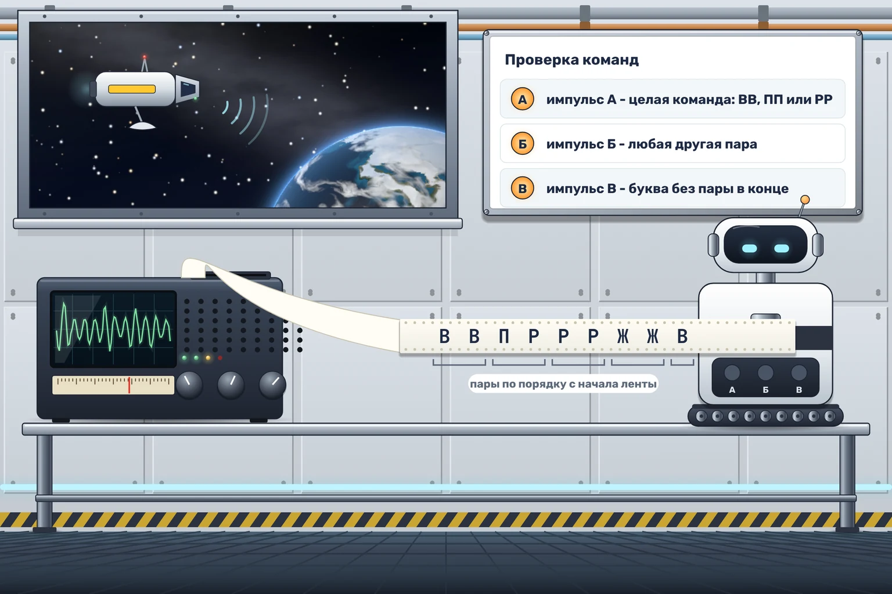

# Двойная подпись

Антенна станции принимает распоряжения с орбитального буксира, но помехи иногда искажают буквы. Чтобы ошибка не превратилась в команду, каждую команду передают дважды подряд, например ВВ, ПП или РР. Прежде чем команды попадут к исполнителям, их проверяет Строчник.

Строчник читает строку парами, сначала первую и вторую буквы, потом третью и четвёртую и так далее. На каждую пару он подаёт один импульс:

- ВВ, ПП или РР - целая команда, импульс А;
- любая другая пара - испорченная команда, импульс Б;
- одна буква без пары в конце строки - обрыв, импульс В.

Две одинаковые чужие буквы, например ЖЖ, тоже считаются испорченной командой. Если строка пустая, импульсов нет.

Например, строка ВВПРРРЖЖВ делится на ВВ, ПР, РР, ЖЖ и одну букву В. Импульсы получаются такие: А, Б, А, Б, В.

Читайте строку действием «Принять символ», пока не придёт событие «Строка закончилась».
