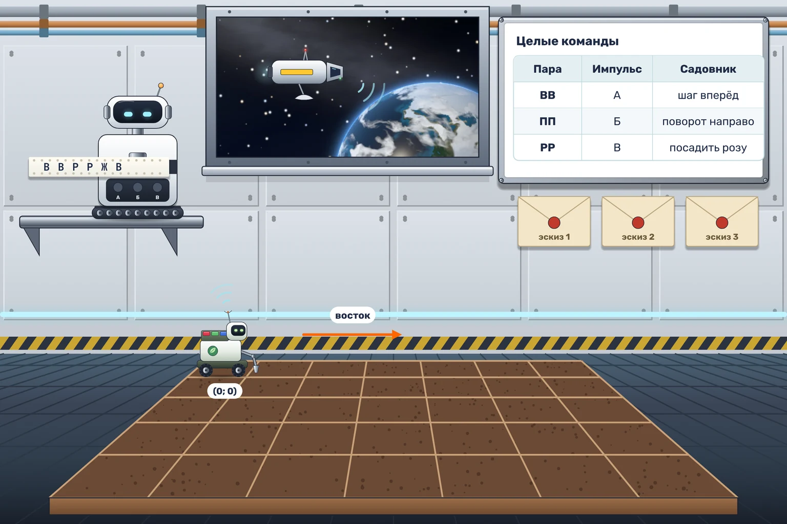

# Посадка с орбиты

К открытию оранжереи орбитальный буксир прислал три цветочных эскиза. Эскизы пришли командами для Садовника, но на ленте есть помехи и оборванные пары. Если пропустить ошибку, роза вырастет в чужой клетке или Садовник уедет прямо в стену. Поручите Строчнику проверять ленту.

Постройте две диаграммы в одном документе, для Строчника и для Садовника, и запустите их вместе в режиме «Строчник + Садовник».

Строчник читает строку парами с самого начала. Целых команд всего три:

| Пара на ленте | Импульс Строчника | Что делает Садовник |
| --- | --- | --- |
| ВВ | А | шагает на одну клетку вперёд |
| ПП | Б | поворачивается направо |
| РР | В | сажает розу в своей клетке |

Все другие пары пропускайте целиком, даже две одинаковые чужие буквы. Последнюю букву без пары тоже пропускайте. Пары всегда считаются от начала строки, поэтому испорченная пара не сдвигает следующие.

Поле пустое, 7 × 5 клеток. Садовник начинает в левом верхнем углу, в клетке (0; 0), и смотрит на восток. Выполняйте только целые команды. Сажать лишние цветы нельзя, двигаться после конца сообщения тоже нельзя.

В трёх основных тестах Садовник выращивает три разных знака из роз. Запустите тесты и посмотрите, какие фигуры получились.
