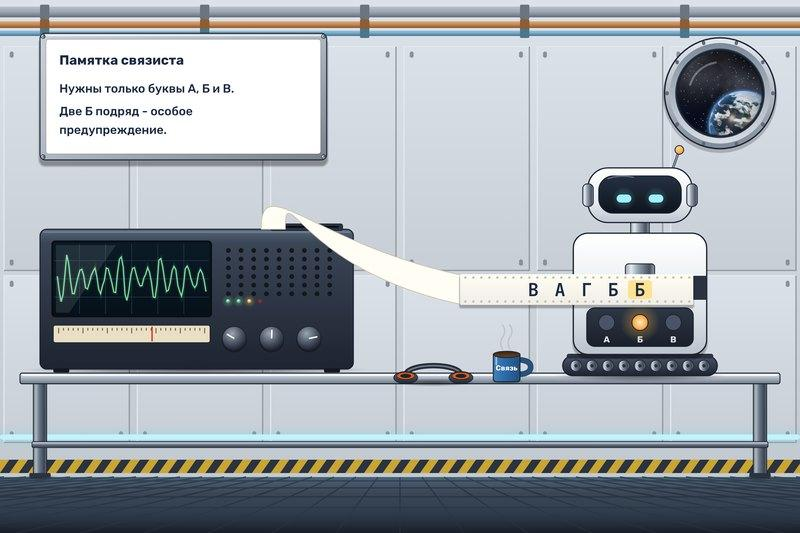

# Строчник на приёме

В радиорубке станции заработал старый ленточный приёмник. На ленте много лишнего, а дежурному связисту важны только три буквы: А, Б и В. Строчник будет читать ленту и подавать короткие импульсы. Две Б подряд означают особое предупреждение.

Читайте строку слева направо, по одному символу:

- на А подавайте импульс А;
- на Б подавайте импульс Б;
- на В подавайте импульс В;
- остальные символы пропускайте.

Если текущая буква Б и предыдущая тоже Б, после импульса Б подайте ещё импульс В. В цепочке БББ импульс В подаётся и на второй, и на третьей Б. Любой другой символ цепочку прерывает.

Для строки ВАГББ импульсы идут в таком порядке: В, А, Б, Б, В. После конца строки новых импульсов не подавайте.

Следующий символ Строчник получает только после действия «Принять символ». Ставьте это действие и после пропущенных символов.
